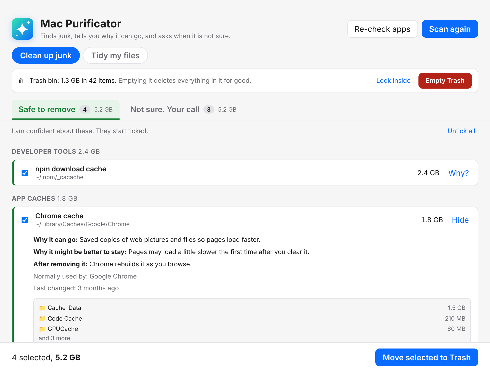
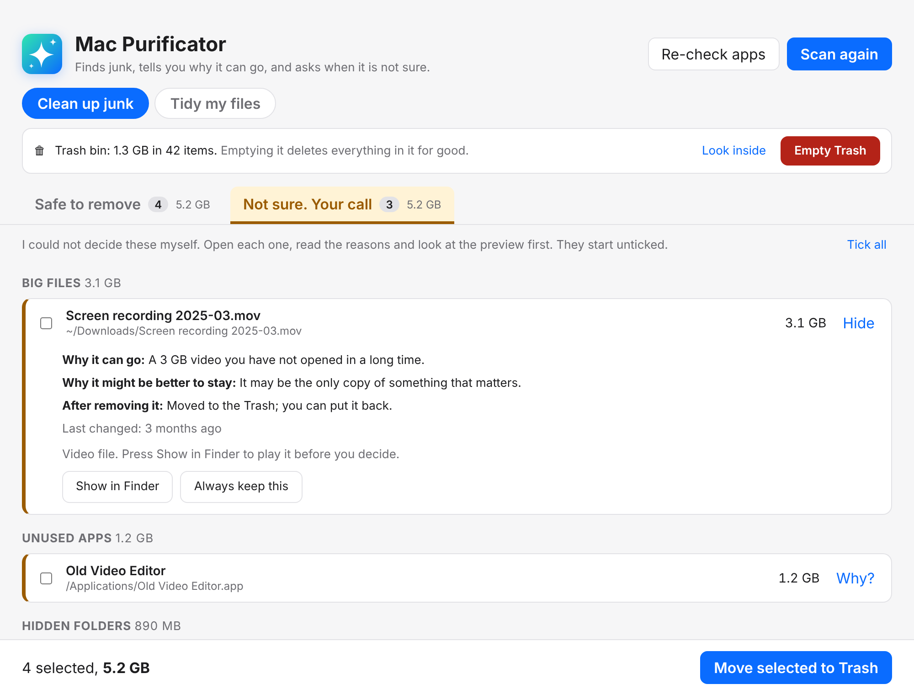
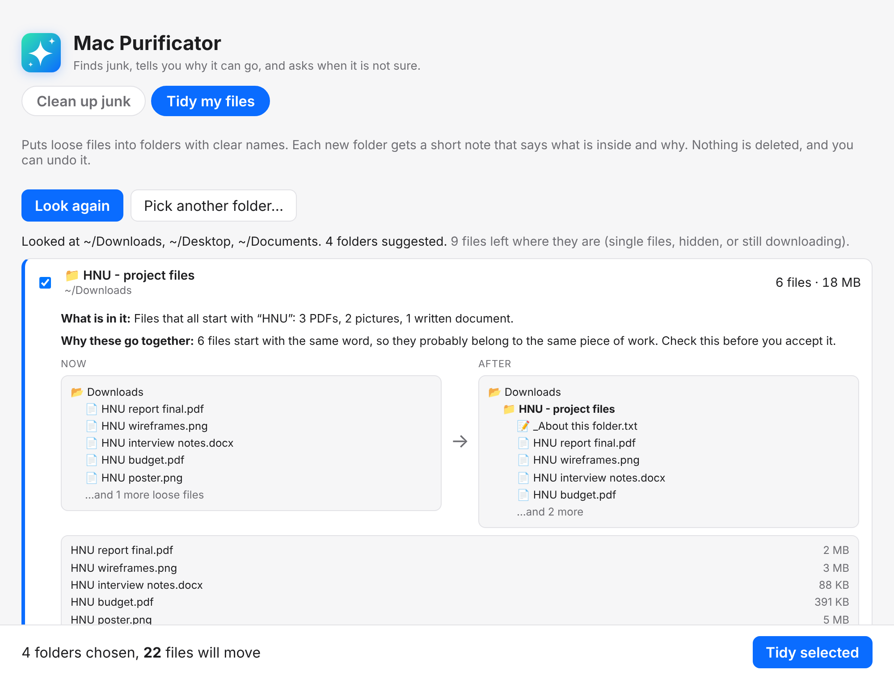

# Mac Purificator

A Mac desktop app (Electron + React + TypeScript) that finds junk, explains **why it can go** and **why it might be better to stay**, and asks you when it is not sure.

## What it looks like

These pictures use made-up sample files, not a real Mac.





## Install it as a Mac app

```bash
npm install
npm run package      # builds "Mac Purificator.app" into the release folder
npm run install-app  # copies it to your Applications folder
```

Then open it from Launchpad or Spotlight. Build it on the Mac you will use it on. The first time, macOS may ask if the app can control Finder (needed to empty the Trash).

## Try it in your browser

There is a demo with sample files in the `demo/` folder. It is a web page, so nothing on your computer is scanned or deleted. To put it online with Vercel, import this repo and set **Root Directory** to `demo`.

## Run it

```bash
npm install
npm start        # builds and opens the app
npm run dev      # development mode with live reload
npm test         # scanner tests on a fake home folder
```

## How it works

- **Scan** changes nothing. It builds a list.
- Two tabs: **Safe to remove** (starts ticked) and **Not sure. Your call** (starts unticked, with reasons).
- Every row has a **Why?** button: why it can go, why it might stay, what happens after removing it, and a **preview** (pictures, text files, folder contents).
- **App check:** before anything is moved, the app looks at which apps and programs are running and which files are open. If an app is using the item, it is blocked and the row says which app. Quit the app, then press **Re-check apps**.
- Approved items go to the **Trash** (never permanent delete).
- **Empty Trash** (top of the window) deletes what is in the Trash **for good**. It shows how much is in there, lets you look inside, and asks you to confirm in a macOS window first. It also empties the Trash on plugged-in drives. The first time, macOS asks if the app may control Finder. Say OK.
- **Always keep this** hides an item from every future scan.

## Tidy my files

The second button at the top. It looks at loose files in Downloads, Desktop and Documents (and a folder you pick) and suggests folders with names that say what is inside, like `PDF Documents`, `Photos and Pictures`, `Screenshots and Screen Recordings - 2026-10` or `HNU - project files`.

- Files that start with the same word are grouped as a project. The rest are grouped by kind. A group needs 3 or more files.
- Each new folder gets `_About this folder.txt` with what is inside and why.
- Nothing is deleted or overwritten. Files with the same name get `(2)`. **Undo last tidy** puts everything back.
- Left alone: hidden files, folders, apps, files still downloading, files changed in the last 10 minutes, and code projects (folders with `package.json`, `.git` and so on).

## What it looks at

| Area | Examples |
| --- | --- |
| Claude leftovers | Claude Code debug logs, shell snapshots, old task lists, old chat history, Claude app caches and logs |
| App caches and logs | `~/Library/Caches`, old logs, VS Code caches |
| Developer tools | npm / pnpm / Gradle / Maven / Cargo caches, `~/.cache` |
| Xcode | DerivedData, simulator caches, archives, device support |
| Old project files | `node_modules`, `.next`, `.venv`, `target`, `Pods` (checks lockfile and how long since you touched the project) |
| Installers, big files, duplicates | `.dmg` / `.pkg` in Downloads, files over 500 MB, exact copies |
| Backups and mail | iPhone backups, opened Mail attachments |
| Unused apps | Apps in `/Applications` not opened for 180 days. Apps that came with macOS are never shown. App Store apps are "Safe" (free to download again). Others are "Not sure" (you may need the licence key) |
| Hidden folders | Known ones (`.nvm`, `.npm` logs, `.expo`, `.vscode` extensions, `.adobe`, `.nuget`, old Terminal history), hidden project caches (`.angular`, `.dart_tool`, `.gradle`, `.pytest_cache`, `.mypy_cache`, `.ruff_cache`), hidden folders inside Downloads and Documents, and any other hidden folder over 200 MB in your home folder (always "Not sure") |

## Safety

- `src/main/safety.ts` blocks anything it should never touch (Documents, Desktop, Keychains, `.ssh`, Git history, photo libraries, your Claude settings / skills / commands, `.env` files). It runs at scan time and again right before moving anything.
- Hidden folders that hold logins, keys or settings (`.ssh`, `.config`, `.docker`, `.local`, `.gnupg`, `.aws`, shell files) are never offered.
- The window can only ask to clean items from the last scan. It cannot send file paths.
- Rules live in `src/main/rules.ts`. To add one, add an entry with its reasons. Which app owns what is in `src/main/apps.ts`.
- The logo is `assets/icon.svg` (the dock icon is `assets/icon.png`).
